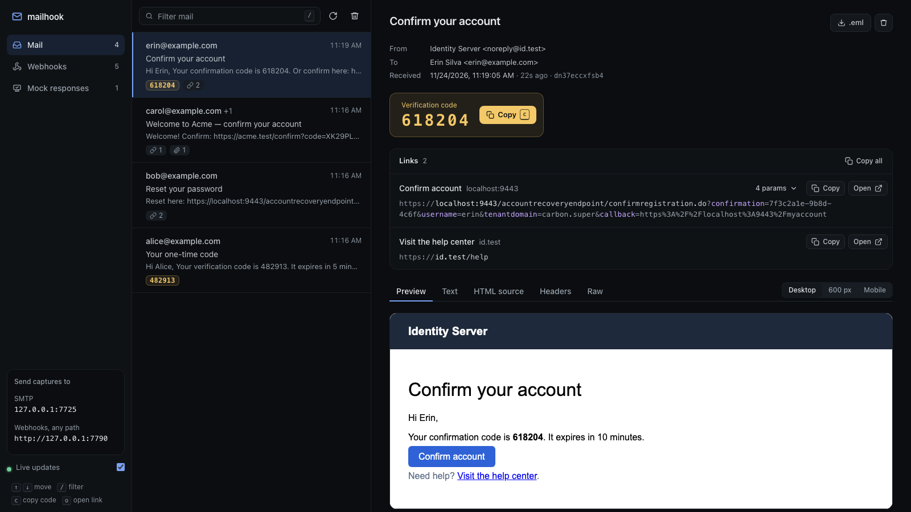
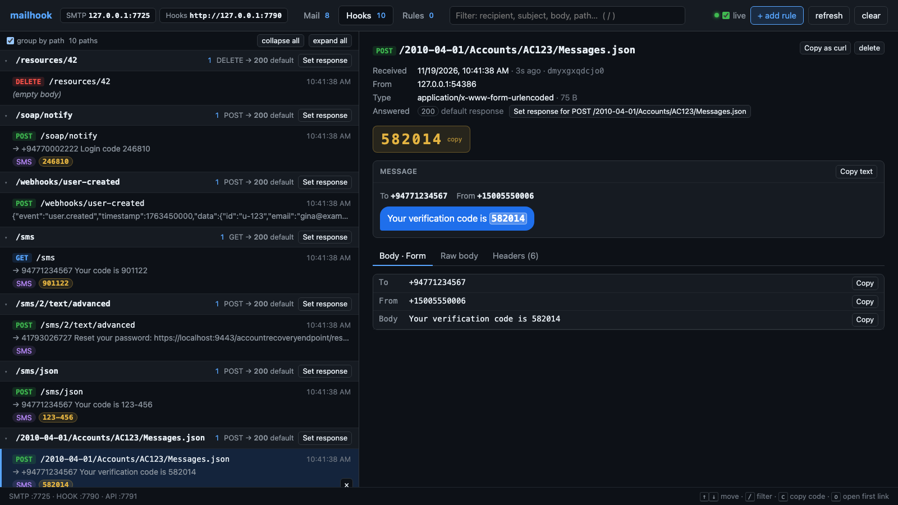

# mailhook

[](https://github.com/PasinduYeshan/mailhook/actions/workflows/ci.yml)
[](https://github.com/PasinduYeshan/mailhook/releases/latest)
[](LICENSE)

Local SMTP catcher + HTTP webhook inspector. One Go binary, zero external
deps. Built for testing WSO2 IS pack flows that send mail (OTP, password
reset) or POST to a notification endpoint (SMS, custom HTTP), but useful
for any app that emits SMTP or webhooks.

- Catches outbound SMTP on `127.0.0.1:7725` (no auth, no TLS, local-only).
- Catches any HTTP method on `127.0.0.1:7790` — captures stay in memory.
- Optional per-`method`+`path` mock responses (Beeceptor-style).
- Pulls out what you test for: one-time codes, links (with query params),
  attachments, and the SMS text/recipient from JSON, form, XML or plain
  bodies (Twilio, Vonage, Infobip, WSO2 IS custom provider, …).
- Web UI on `127.0.0.1:7791`: rendered mail with working links and inline
  images, hooks grouped by path with their mock response, search, live
  updates. Plus a JSON API and a live NDJSON tail.
- ~6 MB binary, ~12 MB RSS, ~0% idle CPU.





## Install

### Linux / macOS (prebuilt binary)

```bash
curl -fsSL https://github.com/PasinduYeshan/mailhook/releases/latest/download/install.sh | sh
```

The script picks the build for your OS and CPU (amd64 or arm64), checks it
against the release's `checksums.txt`, and installs `mailhook` to
`~/.local/bin`. Run it again to upgrade; a running daemon is restarted on
the new version with the same ports.

| Variable               | Effect                                              |
| ---------------------- | --------------------------------------------------- |
| `MAILHOOK_VERSION`     | install a specific release, e.g. `v0.1.0`            |
| `MAILHOOK_INSTALL_DIR` | install somewhere else (default `~/.local/bin`)     |

For example: `curl -fsSL …/install.sh | MAILHOOK_VERSION=v0.1.0 sh`.

<details><summary>Manual download</summary>

Pick your archive from the
[latest release](https://github.com/PasinduYeshan/mailhook/releases/latest)
(`mailhook_<version>_<linux|darwin>_<amd64|arm64>.tar.gz`), check it against
`checksums.txt`, and put the `mailhook` binary on your `PATH`:

```bash
tar -xzf mailhook_*_darwin_arm64.tar.gz mailhook
mv mailhook ~/.local/bin/
mailhook version
```

</details>

Windows is not supported yet (the background daemon uses Unix process
APIs); WSL works.

### With Go

Requires **Go 1.22+**.

```bash
go install github.com/PasinduYeshan/mailhook/cmd/mailhook@latest
```

Lands in `$(go env GOPATH)/bin` (usually `~/go/bin`); add that to `PATH` if
needed.

### From source

```bash
git clone https://github.com/PasinduYeshan/mailhook
cd mailhook
make install              # installs to $HOME/.local/bin
```

## Uninstall

```bash
mailhook stop                                  # stop daemon if running
rm ~/.local/bin/mailhook                       # install script or `make install`
rm "$(go env GOPATH)/bin/mailhook"             # if installed via `go install`

rm -rf "$HOME/.local/var/mailhook"             # optional: remove logs + pidfile
```

## Quick start

```bash
mailhook start                     # background daemon
open http://127.0.0.1:7791/        # web UI

# Send mail to the catcher.
swaks --server localhost:7725 \
      --from is@test.local --to user@example.com \
      --header "Subject: OTP 482913" --body "Code: 482913"

# Or a webhook.
curl -X POST http://localhost:7790/sms/send -d '{"text":"hi"}'

# Inspect from CLI.
mailhook mail list
mailhook hook list
mailhook tail

mailhook stop                      # when done
```

## Other commands

| Command                | What it does                                      |
| ---------------------- | ------------------------------------------------- |
| `mailhook start`       | start daemon in background                        |
| `mailhook stop`        | stop this daemon (`--all`: every mailhook serve)  |
| `mailhook restart`     | stop then start                                   |
| `mailhook status`      | show pid, RSS, CPU                                |
| `mailhook logs`        | `tail -f` the daemon log                          |
| `mailhook serve`       | run in the foreground                             |
| `mailhook mail …`      | list / show / code / links / delete captured mail |
| `mailhook hook …`      | list / show / code / links / delete webhook hits  |
| `mailhook rule …`      | add / list / update / delete mock-response rules  |
| `mailhook tail`        | live NDJSON stream of new captures                |

Full reference: see [`docs/cli.md`](docs/cli.md).

## Documentation

| Topic            | File                                            |
| ---------------- | ----------------------------------------------- |
| CLI reference    | [`docs/cli.md`](docs/cli.md)                    |
| HTTP API         | [`docs/api.md`](docs/api.md)                    |
| Mock rules       | [`docs/rules.md`](docs/rules.md)                |
| WSO2 IS pack     | [`docs/integration.md`](docs/integration.md)    |
| Internals        | [`docs/architecture.md`](docs/architecture.md)  |
| Agent skill      | [`SKILL.md`](SKILL.md)                          |

## Releasing

Tag a commit and push the tag; the
[release workflow](.github/workflows/release.yml) runs GoReleaser, builds
Linux and macOS archives, and publishes a GitHub release with checksums and
`install.sh`.

```bash
git tag v0.1.0
git push origin v0.1.0
```

`make snapshot` does the same build locally into `./dist` without publishing.

## License

MIT.
